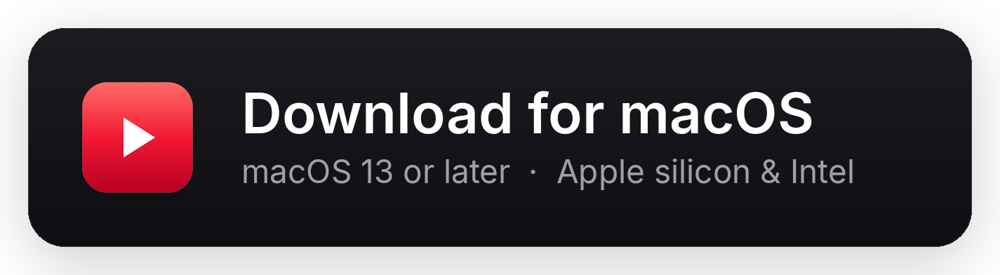
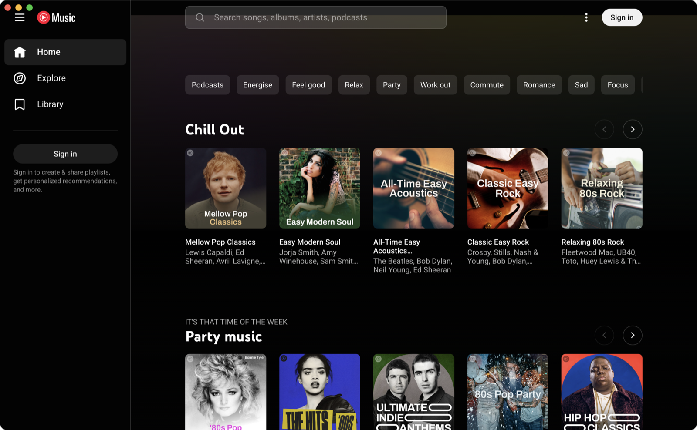
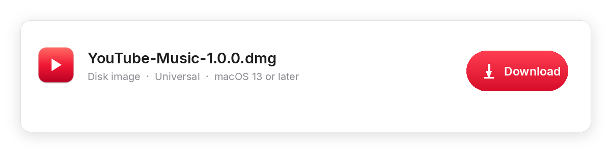
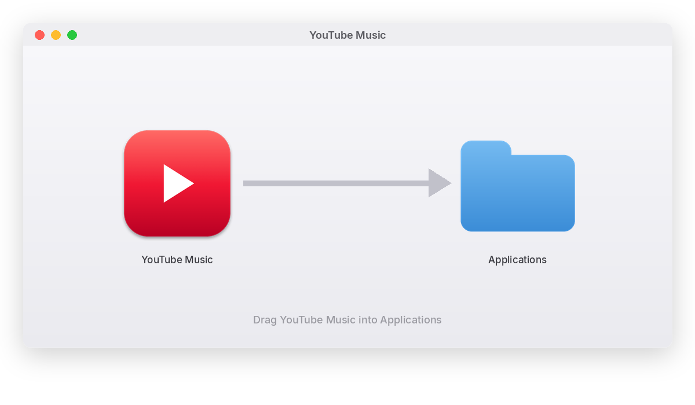
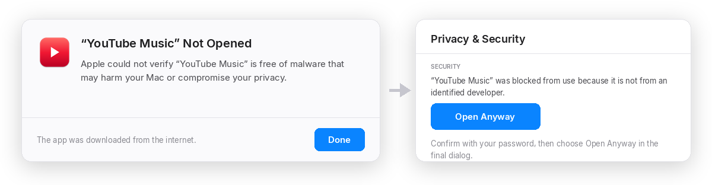
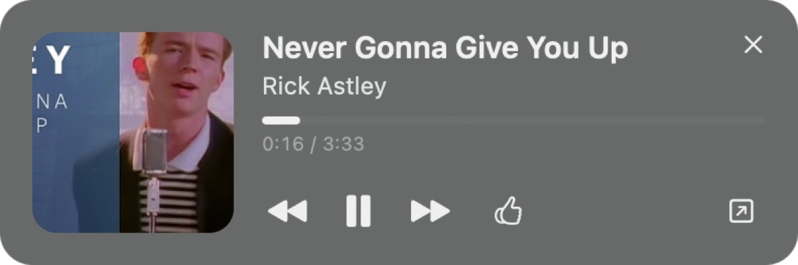
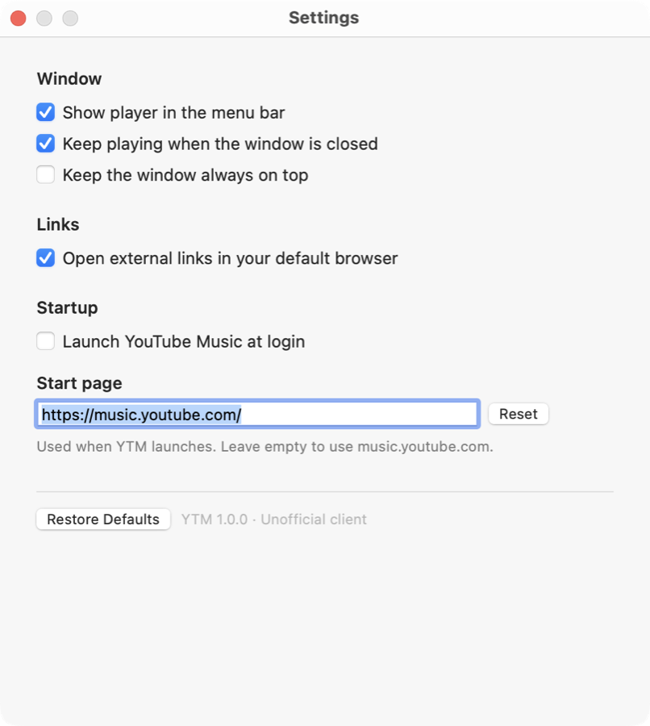

# YouTube Music

A native macOS desktop app for YouTube Music. The app wraps the real
[music.youtube.com](https://music.youtube.com) in AppKit and WebKit, so the
interface, recommendations, library, and playback are exactly the web app —
with native window behavior, media keys, and macOS integrations around it.

> Unofficial client. Not affiliated with, endorsed by, or sponsored by Google
> LLC. YouTube Music is a trademark of Google LLC.

<p align="center">
  <a href="https://github.com/Joaosilva27/ytm-desktop/releases/latest">
    
  </a>
</p>



## Install

No build tools, no Terminal. Grab the disk image from the
[latest release](https://github.com/Joaosilva27/ytm-desktop/releases/latest) —
it is a universal build, so the same download runs on Apple silicon and Intel.

### 1. Download the disk image

Under **Assets** on the release page, download `YouTube-Music-<version>.dmg`.



### 2. Drag the app into Applications

Double-click the `.dmg` to open it, then drag **YouTube Music** onto the
**Applications** folder next to it. That is the whole installation. Eject the
disk image when you are done.



### 3. Allow the app to open, once

The app is built outside the App Store and is not notarized by Apple, so the
first launch is blocked with *"YouTube Music" Not Opened* — macOS cannot verify
an app it has never seen before.

Open **System Settings → Privacy & Security**, scroll to **Security**, and click
**Open Anyway** next to the message about YouTube Music. Confirm with your
password or Touch ID, then click **Open Anyway** in the final dialog.



macOS remembers the decision, so this happens only on the first launch. On
macOS 13 and 14 you can also right-click the app in Applications, choose
**Open**, and confirm.

If you would rather do it from the terminal, the effect is the same:

```sh
xattr -dr com.apple.quarantine "/Applications/YouTube Music.app"
```

### After installing

1. Open YouTube Music and click **Sign in** to complete Google's sign-in flow
   in the app window.
2. Play something. Click **Mini Player** in the title bar (or use
   **View → Show Mini Player**) to open the floating player.

Credentials are entered directly on Google's pages; the app never reads or
stores them. Authentication redirects never leave the app for a browser.

### Uninstall

Quit the app, then drag **YouTube Music** from Applications to the Bin. Your
session and settings live in `~/Library/WebKit/com.joaosilva.ytmdesktop`; remove
that folder too if you want a clean slate. Turn off **Launch at login** in
Settings first if you enabled it.

## Features

- **The real YouTube Music** — no reimplementation, no missing features. Sign
  in and your playlists, uploads, likes, and history are all there.
- **Persistent session** — cookies and site data live in the app's WebKit
  profile, so you stay signed in between launches.
- **Native window** — transparent full-size title bar with a real AppKit titlebar
  strip, so YouTube Music's layout is never stretched by CSS. The traffic lights
  and a visible **Mini Player** button sit above the page, and the app supports
  full screen, zoom, and back/forward gestures.
- **Now Playing integration** — Control Center, the macOS Now Playing panel,
  and hardware media keys control playback. The Mac is kept awake while music
  is playing.
- **Menu bar player** — play/pause, previous/next, like, artwork-free compact
  menu, and quick access to the window, mini player, and settings.
- **Mini player** — a floating always-on-top player with artwork, progress,
  and playback controls. Open it from the **Mini Player** button in the title
  bar, the View menu, the menu bar, or with ⌘⇧M. Tiny is the default size; use
  the resize button in the player to toggle between Tiny and your last larger
  size, or choose Regular, Compact, or Tiny in **Settings → Mini Player**.
- **Ad blocking** — a bundled content blocker removes known ad and tracking
  requests and hides promotional surfaces. A page script also strips ad
  metadata and fast-forwards in-player ads. Control it in
  **Settings → Privacy**.
- **Audio-only by default** — playback uses YouTube's audio-only stream for the
  current track, so no music video is displayed and the player shows the track
  artwork instead. When a track has a video, click the
  **Video** button in the title bar, use **View → Show Video**, or press ⌥⌘V
  to switch back to the video stream. The next track returns to audio-only
  automatically.
- **Dock menu** — playback controls plus quick access to the window and mini
  player, without bringing the window forward.
- **Native settings** — start page, menu bar player, keep-playing-on-close,
  always-on-top, ad blocking, external links, and launch at login.
- **Resilient** — loading and offline states, retry, and automatic reload if
  the WebKit content process is terminated.

| Mini player | Settings |
| --- | --- |
|  |  |

## Requirements

To use the app: macOS 13 Ventura or later, Apple silicon or Intel. Nothing else.

To build it: macOS 13 or later and the Xcode Command Line Tools
(`xcode-select --install`). There are no third-party dependencies and no Xcode
project to open.

## Build from source

```sh
git clone <this-repo> ytm-desktop
cd ytm-desktop
./Tools/build.sh
open "dist/YouTube Music.app"
```

To build and copy the app into `/Applications` in one step:

```sh
./Tools/build.sh --install
```

The build compiles the Objective-C sources with `clang`, assembles
`dist/YouTube Music.app`, copies the JavaScript resources, and ad-hoc signs the bundle.
The app is built locally, so it is not notarized.

To produce a distributable universal build and a drag-to-install disk image —
the same two commands the release workflow runs:

```sh
UNIVERSAL=1 VERSION=1.0.0 ./Tools/build.sh
./Tools/make-dmg.sh
```

`Tools/make-dmg.sh` writes `dist/YouTube-Music-<version>.dmg` plus a `.sha256`
checksum, with the app, an Applications shortcut, and a Finder window layout.

## Cutting a release

Releases are built on GitHub's macOS runners — no Mac needed. Bump
`CFBundleShortVersionString` in `Resources/Info.plist`, commit, and merge to
`main`: [`.github/workflows/release.yml`](.github/workflows/release.yml) builds
a universal app, packages the disk image, and publishes the release page for
`v<version>` using [`.github/release-notes.md`](.github/release-notes.md) as the
body, with the changelog taken from the commits since the previous tag. A
version that already has a tag is skipped, so ordinary pushes to `main` do not
republish.

Pushing a tag (`git tag v1.1.0 && git push origin v1.1.0`) or starting the
workflow by hand from the Actions tab publishes immediately.

## How it works

- `Sources/WebController.m` owns the `WKWebView`, navigation policy, the
  JavaScript bridge, and in-app Google authentication. Internal links and
  sign-in redirects stay in the app; blank scripted popups are ignored so the
  page can never be replaced by an empty black document.
- `Resources/PlayerBridge.js` reads player state from the page and exposes
  play/pause, seek, previous/next, and like commands.
- `Sources/NowPlayingService.m` publishes metadata to MediaPlayer and handles
  remote commands and sleep prevention.
- `Sources/MainWindowController.m` builds the native 28pt titlebar strip and
  the **Mini Player** button, and keeps the page below the traffic lights in
  windowed mode and edge-to-edge in full screen.
- `Sources/StatusItemController.m` and `Sources/MiniPlayerController.m` provide
  the other native surfaces.
- `Sources/AdBlocker.m` compiles the bundled WebKit content-rule list and
  attaches it to the web view. `Resources/AdBlockRules.json` blocks known ad
  hosts and YouTube ad endpoints and hides promotional UI.
- `Resources/AdBlocker.js` prunes ad fields from player responses and
  fast-forwards any in-player ads that still appear.
- `Resources/AudioOnly.js` hooks the music app's player API to request
  YouTube's `audio_only=1` stream for every queue load, swaps in the track
  artwork while that stream plays, and exposes the per-track video toggle to
  the native titlebar.
- `Sources/LoginItemManager.m` manages a LaunchAgent in
  `~/Library/LaunchAgents` for launch at login.

The WebKit view uses a persistent data store at
`~/Library/WebKit/com.joaosilva.ytmdesktop` (plus the usual WebKit caches).

## Development

Build and run the snapshot harness used during development:

```sh
./Tools/snapshot.sh build/snapshot.png 12
```

The app also accepts hidden environment variables for local testing, including
`YTM_START_URL`,
`YTM_ACTION=mini|minibutton|minisize|settings|fullscreen|adblocktoggle|video`, `YTM_SNAPSHOT`,
`YTM_SNAPSHOT_MODE=window`, and `YTM_EPHEMERAL=1` (uses a non-persistent
WebKit profile). These are not user-facing settings.

Re-generate the app icon after editing `Tools/IconGen.m`:

```sh
./Tools/make-icon.sh
```

Re-generate the README and disk-image artwork (needs Python 3 and Pillow):

```sh
python3 Tools/make-docs-images.py
```

## Known limitations

- Playback, ads, and account behavior follow YouTube Music's web client and
  require an internet connection.
- Offline downloads and DRM-protected content are limited to what the web
  player itself supports.
- Launch at login writes a user LaunchAgent; moving the app after enabling the
  setting can leave a stale path behind. Toggle it off and on after moving the
  app.
- Some Google pages may ask you to verify the browser during sign-in. Complete
  the challenge in the app window.
- Ad blocking is best-effort: YouTube changes its ad delivery and player
  internals regularly. If playback misbehaves, turn off **Block ads and
  sponsored content** in Settings.
- Audio-only mode follows YouTube's own player availability. On the rare
  tracks where YouTube blocks audio-only playback, the player may keep using
  the video stream; the **Video** toggle remains available.

## License

MIT. See [LICENSE](LICENSE).
